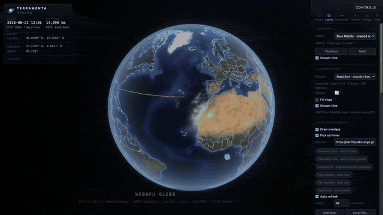
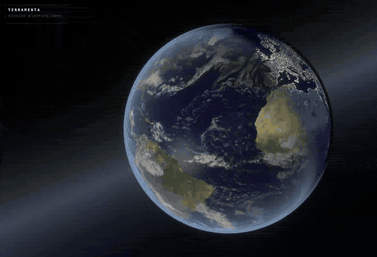
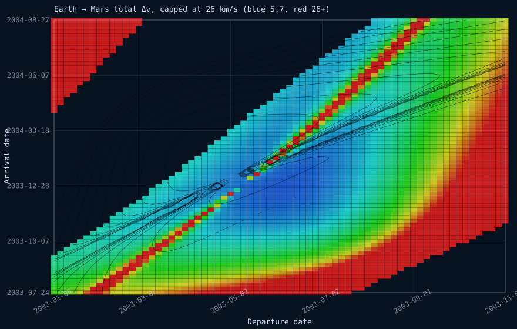

# Terramenta

Astrodynamics, mission design and geospatial analysis on a 3D globe, in the
browser. Rust throughout: an `f64` flight-dynamics library, a
[Bevy](https://bevy.org) 0.19 renderer over WebGPU compiled to WebAssembly, and
a dependency-free web client driven by `*.terramenta.json` project files. The
globe also builds natively (Metal, Vulkan, DX12).

[](docs/tour.mp4)

*Recorded in Chromium over WebGPU from the bundled projects
([`docs/tour.mjs`](docs/tour.mjs)). [Full-resolution video](docs/tour.mp4).*

Rewrite of the JavaFX + NetBeans Terramenta GIS platform
(originally https://bitbucket.org/teamninjaneer/terramenta/; fork archived at
https://github.com/emxsys/emxsys-terramenta), on a different stack and without
aiming for parity with it. Pull requests are not being accepted at this time.

## Features

### Flight dynamics — [`terramenta-solare`](terramenta-solare/)

- **Propagation.** Cowell on `[r, v, m]` with RK4, RKF7(8), DOP853; two-body;
  SGP4 (TLE/OMM); tabulated (Lagrange/Hermite). One `Spacecraft` type switches
  between them mid-mission.
- **Force models.** EGM2008 spherical harmonics (20×20 embedded, ICGEM `.gfc`
  to 120×120), third body (DE440 via [`anise`](https://docs.rs/anise) or analytic
  Moon), drag (exponential, Harris–Priester, NRLMSISE-00 with CelesTrak space
  weather), SRP with conical shadow, Schwarzschild relativity. Flat-plate
  vehicle models whose drag area and SRP follow the attitude.
- **Time and frames.** [`hifitime`](https://docs.rs/hifitime) epochs
  (UTC/TAI/TT/TDB/UT1); IERS EOP; GCRF/TEME/ITRF via IAU-76/FK5 or IAU-2006 CIO
  ([`sofars`](https://docs.rs/sofars)); WGS-84; a frame tree rooted at the
  Solar System Barycentre.
- **Maneuvers and sequences.** Impulsive and finite burns in inertial, VNB,
  RSW, LVLH or body frames. Mission sequences: propagate to epoch, duration,
  apsis, node or any osculating-quantity crossing; burn; nested targets.
- **Targeting.** Newton differential correction with finite-difference
  Jacobians, step caps and backtracking.
- **Covariance.** State transition matrix from variational equations, SNC
  process noise, RSW/position ellipsoids.
- **Orbit determination.** Range, range-rate, az/el, RA/Dec and GNSS
  measurements with light time; batch least squares (Cd/Cr solve-for, σ
  editing) and EKF (Joseph form, gating); simulated tracking.
- **Conjunction assessment.** Range-minimum TCA search, Foster 2D Pc, Alfano
  max Pc, RSW miss geometry.
- **Events.** Ground-station contacts with elevation and terrain-horizon masks,
  conical eclipses, apsides, nodes.
- **Attitude.** Align/constrain (TRIAD), inertial quaternion, spin; nadir,
  Sun, velocity, orbit-normal and target directions; LVLH Euler angles; sensor
  off-axis angles.
- **Coverage.** Cone and rectangular sensor fields of view, WGS-84 footprints,
  H3 grids ([`h3o`](https://docs.rs/h3o)) with access fraction, revisit and
  gap statistics.
- **Terrain.** Terrarium DEM tile mosaics; per-azimuth horizon masks by ray
  march with refraction.
- **Interplanetary.** Lambert (Vallado universal variables), dated transfer
  planning, launch-window search, Hohmann baseline, patched conics with
  sphere-of-influence handoff, v∞ → parking-orbit departure.

### Validation

| Suite | Reference | Residual |
| --- | --- | --- |
| [`tests/gmat.rs`](terramenta-solare/tests/gmat.rs) | GMAT R2026a: two-body, 20×20, third body, SRP, drag, GR (LEO 1 d, GEO 7 d) | 3 cm – 1.2 m |
| [`tests/validation.rs`](terramenta-solare/tests/validation.rs) | Vallado frame and SGP4 cases; JPL Horizons | < 2 cm; ≤ 5 cm DE440s |
| [`tests/propagation.rs`](terramenta-solare/tests/propagation.rs) | Jacobi integral, J2 secular rates, drag decay, Moon vs DE440s | 8e-13; < 1 %; 0.21 km / 27 d |

Details and the NRLMSISE-00 driver caveat: [terramenta-solare](terramenta-solare/README.md#validation).

### Globe — [`terramenta-globe`](terramenta-globe/)

- Custom-shaded Earth: day/night terminator, city lights, ocean specular,
  clouds, atmosphere, starfield; Sun and Moon placemarks. ECEF and ECI frames,
  plus a GNC overlay drawing both with the sidereal angle.
- Streaming WMS/WMTS imagery (NASA GIBS presets) on a screen-space-error
  quadtree; Mapbox Vector Tiles; GeoJSON with altitude, extrusion,
  simplestyle and live refresh.
- SGP4 satellite layers from OMM (Celestrak groups), propagated every frame;
  numerically propagated spacecraft with trails, 3σ ellipsoids, body axes,
  boresights and sensor footprints; H3 coverage cells.
- Heliocentric view (Sun, Earth, Mars) with an animated transition; flown
  Earth → Mars missions from window search through capture.
- `f64` [GeoArrow](https://geoarrow.org) geometry store; zero-copy
  `Float64Array` views into WASM memory. Cursor picking for every layer.
- One command/state API ([`api.rs`](terramenta-globe/src/api.rs)) for
  JavaScript and Rust; state streamed at ~10 Hz.

### Mission planning app — [`terramenta-webapp`](terramenta-webapp/)

- Projects as JSON Schema-validated `*.terramenta.json` files with versioned
  migrations; open, save, autosave and recovery; undo/redo; switch in place.
- Editors for spacecraft (Keplerian, GCRF, TLE, OMM initial states), forces,
  burns, plates, covariance, sequences, targets, attitude profiles and ground
  stations (horizon from terrain).
- Analysis studies: plots, reports, Δv budgets, porkchops
  ([`terramenta-charta`](terramenta-charta/)), coverage, conjunctions, orbit
  determination.
- Timeline: events keyed to propagated events (burns, AOS) that change clock
  rate, camera and view.

### Interoperability

| Format | Read | Write |
| --- | :-: | :-: |
| CCSDS OEM (with covariance), OPM | ✓ | ✓ |
| CCSDS AEM (attitude), CDM (conjunction), TDM (tracking) | ✓ | ✓ |
| NAIF SPK (Type 9, 13) | ✓ via `anise` | ✓ |
| TLE, OMM JSON | ✓ | |
| IERS / CelesTrak EOP, CelesTrak space weather, ICGEM `.gfc` | ✓ | |
| CZML, STAC 1.1 catalog (zip), GeoJSON, CSV | | ✓ |
| WMS, WMTS, MVT, GeoJSON, Terrarium DEM | ✓ (streamed) | |

## Gallery

[](docs/mission-demo.mp4)

*[`mars-mission`](terramenta-webapp/projects/mars-mission.terramenta.json):
launch-window search, parking-orbit departure in the globe view, heliocentric
cruise, Mars capture. White: flown. Dashed yellow: planned. Cruise
time-accelerated. [Video](docs/mission-demo.mp4).*



*[`docs/satellites.py`](docs/satellites.py): default orbit classes (crewed
stations, Starlink shell, GPS, Molniya, GEO) in the Earth-fixed frame. Radii
compressed; ground tracks, terminator and orbit far sides to scale.*

| | |
| --- | --- |
|  |  |
| [`earth_to_mars.rs`](terramenta-solare/examples/earth_to_mars.rs): Lambert transfer flown with patched conics to Mars SOI | [`porkchop.rs`](terramenta-charta/examples/porkchop.rs): total Δv over departure × arrival, marching-squares contours |

## Bundled projects

`index.html?project=projects/<file>`, or the Project tab.

| Project | Shows |
| --- | --- |
| [`overview`](terramenta-webapp/projects/overview.terramenta.json) | GeoJSON geometry, extrusion, live USGS earthquakes, Celestrak stations |
| [`ground-contacts`](terramenta-webapp/projects/ground-contacts.terramenta.json) | SSO over five stations: contacts, eclipses, nodes |
| [`coverage-study`](terramenta-webapp/projects/coverage-study.terramenta.json) | Six-imager constellation, footprints, H3 revisit, terrain-masked station |
| [`attitude-modes`](terramenta-webapp/projects/attitude-modes.terramenta.json) | LVLH, sun-constrained target tracking, inertial spin; AEM |
| [`leo-transfer`](terramenta-webapp/projects/leo-transfer.terramenta.json) | Hohmann transfer, covariance, plots, OEM/SPK/CZML export |
| [`targeted-transfer`](terramenta-webapp/projects/targeted-transfer.terramenta.json) | Differential correction of impulsive and finite burns |
| [`geo-transfer`](terramenta-webapp/projects/geo-transfer.terramenta.json) | LEO → GEO mission sequence with nested targets |
| [`differential-drag`](terramenta-webapp/projects/differential-drag.terramenta.json) | Plate-model smallsats: attitude-driven decay, body-frame thrust |
| [`conjunction-screening`](terramenta-webapp/projects/conjunction-screening.terramenta.json) | TCA, miss, Pc against debris and a catalogue; CDM |
| [`orbit-determination`](terramenta-webapp/projects/orbit-determination.terramenta.json) | Radar batch LSQ with Cd, GNSS EKF; residuals, TDM |
| [`mars-windows`](terramenta-webapp/projects/mars-windows.terramenta.json) | Earth → Mars porkchops, 2026 and 2028 |
| [`mars-mission`](terramenta-webapp/projects/mars-mission.terramenta.json) | Directed Earth → Mars flight |

## Components

| Crate / directory | Role |
| --- | --- |
| [`terramenta-solare`](terramenta-solare/) | Flight dynamics. Pure Rust, `f64`, no Bevy. |
| [`terramenta-globe`](terramenta-globe/) | Renderer and command/state API; WASM via `wasm-bindgen`, or native. |
| [`terramenta-charta`](terramenta-charta/) | Porkchop grid and marching-squares contours; Rust or WASM. |
| [`terramenta-webapp`](terramenta-webapp/) | Reference client: plain HTML/CSS/ES modules, no bundler. |

Dependencies run one way: globe and charta depend on solare; the webapp
depends on the compiled WASM modules.

## Running

### Web app

```sh
rustup target add wasm32-unknown-unknown
cargo install wasm-bindgen-cli --version 0.2.128   # must match the wasm-bindgen crate version
cd terramenta-webapp
./scripts/serve.sh                                 # builds globe + charta modules if needed; http://localhost:8080
```

WebGPU requires a secure context: serve over HTTP(S), not `file://`.
Chrome/Edge 123+, Safari 26+, Firefox 141+ (Linux: `dom.webgpu.enabled`).

### Native globe

```sh
./terramenta-globe/scripts/fetch-assets.sh
cargo run --release --bin terramenta-globe
```

### Tests and examples

```sh
cargo test --workspace
./terramenta-solare/scripts/fetch-data.sh                # DE440s, EOP, space weather, EGM2008; kernel tests skip without it
(cd terramenta-webapp && npm test)
cargo run --example earth_to_mars -p terramenta-solare   # writes terramenta-solare/docs/earth_to_mars.svg
cargo run --example porkchop -p terramenta-charta        # writes terramenta-charta/docs/porkchop.svg
```

## Layout

```
Cargo.toml            Workspace members and build profiles (dev deps at opt-level 3; web-release at opt-level "s")
docs/                 README media, satellites.svg generator, tour recorder
terramenta-solare/    Flight dynamics
terramenta-globe/     Renderer and control API
terramenta-charta/    Porkchop grid and contouring
terramenta-webapp/    Reference web client (not a Cargo member)
```

## Credits

Base Earth imagery: [NASA Visible Earth](https://visibleearth.nasa.gov) Blue
Marble (public domain). Coastlines in `docs/satellites.svg`:
[Natural Earth](https://www.naturalearthdata.com) 110m land (public domain).
Streamed imagery: [NASA GIBS](https://nasa-gibs.github.io/gibs-api-docs/).
Vector tiles: [MapLibre demo tiles](https://demotiles.maplibre.org) and
[OpenStreetMap](https://www.openstreetmap.org/copyright) (ODbL). Terrain:
[AWS Terrain Tiles](https://registry.opendata.aws/terrain-tiles/). Orbital
elements, EOP and space weather: [Celestrak](https://celestrak.org). Ephemerides:
JPL DE440. Gravity: EGM2008 via [ICGEM](https://icgem.gfz-potsdam.de).
Propagation: [`sgp4`](https://github.com/neuromorphicsystems/sgp4) (MIT),
[`nrlmsise00`](https://docs.rs/nrlmsise00) (MIT). Everything else is MIT OR
Apache-2.0.
