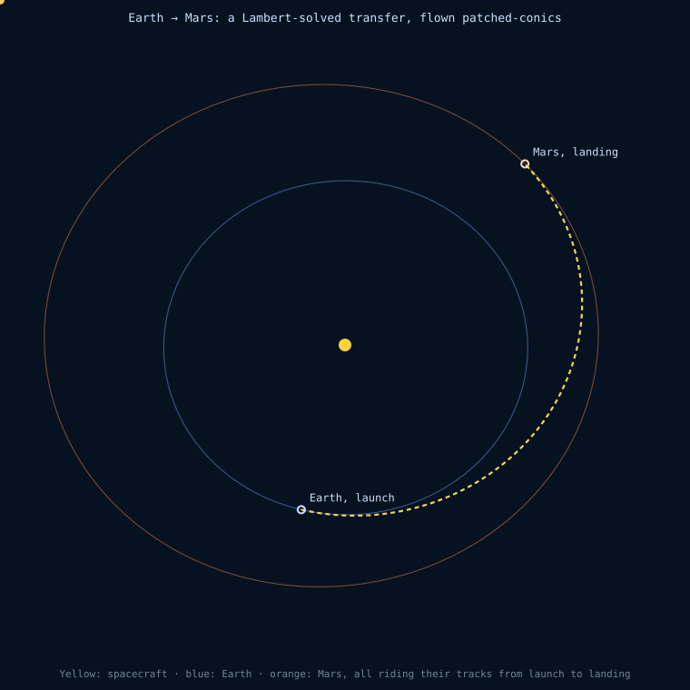

# terramenta-solare

Solar-system astrodynamics in pure Rust (`f64`, [`glam`](https://docs.rs/glam)
`DVec3`): a reference-frame tree rooted at the Solar System Barycentre, two-body
and numerical (Cowell) propagation with force models and maneuvers, SGP4, CCSDS
OEM/OPM I/O, a Lambert solver, transfer planning, and a patched-conics
spacecraft. Used by [`terramenta-globe`](../terramenta-globe/) (heliocentric
view and flown missions) and [`terramenta-charta`](../terramenta-charta/)
(porkchop plots). No WebAssembly binding of its own; callers link it as a Rust
dependency.



*Generated by [`examples/earth_to_mars.rs`](examples/earth_to_mars.rs): solves
[`lambert::solve`](src/lambert.rs) for a near-optimal Earth–Mars window, spawns
a [`Spacecraft`](src/spacecraft.rs) on the transfer orbit at Earth's position,
and calls `Spacecraft::update` hourly until Mars captures it. The departure
burn is instantaneous and heliocentric only (Earth escape is not modelled in
this example).*

## Modules

| Module | Contents |
| --- | --- |
| [`frame`](src/frame.rs) | `FrameTree`, `FrameId`, `StateVector`, `Ephemeris`, `Relative` (one tree node relative to another, as an `Ephemeris`). Each node reports state relative to its parent; `state_of_relative_to` walks to the nearest common ancestor and subtracts there, avoiding precision loss from a single distant origin. |
| [`sun`](src/sun.rs) | Sun position relative to the SSB. |
| [`planets`](src/planets.rs) | Earth and Mars from JPL low-precision mean elements at J2000 plus rates (valid 1800–2050). |
| [`ecliptic`](src/ecliptic.rs) | Ecliptic → equatorial rotation applied to published planetary elements. |
| [`bodies`](src/bodies.rs) | `GM` and mean radius per body; `sphere_of_influence_km` (Laplace SOI). |
| [`time`](src/time.rs) | `Epoch` on [`hifitime`](https://docs.rs/hifitime), stored in TAI. Unix seconds are UTC with leap seconds. TT/TDB/UTC/UT1 accessors; SOFA two-part JDs. |
| [`eop`](src/eop.rs) | `EopTable`: IERS `finals*.all` and CelesTrak `EOP-All.csv` parsers; linear interpolation, leap-second-aware UT1−UTC. |
| [`earth`](src/earth.rs) | GCRF/TEME ↔ ITRF (`EarthModel::{Iau76Fk5, Iau2006Cio}`) via [`sofars`](https://docs.rs/sofars); GMST82, GAST, ERA; WGS-84 geodetic ↔ ECEF. |
| [`spice`](src/spice.rs) | `KernelEphemeris`: SPK states (DE440/DE440s) via [`anise`](https://docs.rs/anise), with optional low-precision fallback. `solar_system_from_kernels`: SSB, Sun, planets, Moon. |
| [`propagate`](src/propagate/mod.rs) | `Propagator`: Cowell on `[r, v, m]`, impulsive maneuvers, sampled output, forward/backward. `Integrator`: RK4, RKF7(8), DOP853. `BodyOrientation` / `EarthOrientation` (cached, Earth rotation applied exactly between refreshes). |
| [`force`](src/force/mod.rs) | `ForceModel` trait. `SphericalHarmonics` (normalised Cunningham V/W, EGM2008 20×20 embedded, ICGEM `.gfc` loader), `PointMass`, `ThirdBody` (Battin f(q)), `Drag` with `ExponentialAtmosphere` (Vallado) / `HarrisPriester`, `SolarRadiationPressure` (conical shadow), `Relativity` (Schwarzschild). |
| [`maneuver`](src/maneuver.rs) | `ImpulsiveManeuver` (rocket-equation mass), `FiniteBurn` (thrust, Isp, ṁ; cut-off at dry mass), `LocalFrame::{Inertial, Vnb, Rsw, Lvlh}`. |
| [`interpolate`](src/interpolate.rs) | `SampledEphemeris`: Lagrange / Hermite interpolation of tabulated states; implements `Ephemeris`. |
| [`ccsds`](src/ccsds.rs) | OEM and OPM (CCSDS 502.0-B-3, KVN) read/write. UTC/TAI/TT/TDB/GPS; UTC leap seconds as `:60`. |
| [`tle`](src/tle.rs) | `Sgp4Ephemeris`: TLE/OMM via [`sgp4`](https://docs.rs/sgp4) (AFSPC/WGS-72 mode), TEME or GCRF output. |
| [`orbit`](src/orbit.rs) | `OrbitalElements`: state vector ↔ classical elements, two-body propagation (`state_at`). |
| [`lambert`](src/lambert.rs) | `solve`: Vallado universal-variable Lambert solver with Stumpff functions; `TransferDirection::{Prograde, Retrograde}`. |
| [`mission`](src/mission.rs) | `plan_transfer` (dated body-to-body Δv against the ephemeris), `find_best_transfer_window` (grid search for minimum total Δv), `hohmann_transfer` (coplanar circular baseline). |
| [`departure`](src/departure.rs) | `injection_state` and `escape_injection_state`: v∞ → parking-orbit departure state. The escape variant matches the target speed at the SOI radius rather than at infinity. |
| [`spacecraft`](src/spacecraft.rs) | `Spacecraft` and `Primary`: patched-conics tracking with SOI escape and capture. |

`solar_system()` returns a `FrameTree` with the SSB at the root and Sun, Earth
and Mars as children.
`spice::solar_system_from_kernels(almanac)` returns the same names plus
Mercury–Pluto (barycentres) and the Moon (under Earth), from loaded kernels.

## Data

```sh
./scripts/fetch-data.sh   # data/de440s.bsp, finals2000A.all, EOP-All.csv, EGM2008_120.gfc
```

Not committed. Kernel- and EOP-dependent tests skip when files are absent.

## Validation

[`tests/validation.rs`](tests/validation.rs):

| Case | Reference | Residual |
| --- | --- | --- |
| ITRF → GCRF, IAU-76/FK5 | Vallado 4th ed. Ex. 3-15 | < 2 cm, < 2e-5 m/s |
| ITRF → GCRF, IAU-2006 CIO | Vallado Ex. 3-15 | < 50 cm |
| TEME → ITRF, TEME → GCRF | Vallado et al. AIAA 2006-6753 | < 2 cm |
| GMST82 | Vallado Ex. 3-5 | < 1e-6° |
| DE440s: Earth, Mars, Sun, Jupiter / SSB; Moon / Earth | JPL Horizons (DE441), 2000 and 2026 | ≤ 5 cm; Moon ≤ 2.3 m |
| EOP files at 2004-04-06 | Vallado Ex. 3-15 | ≤ 0.5 mas, 0.1 ms |
| SGP4 case 00005, 0 and 360 min | Vallado AIAA 2006-6753 | < 1 mm |

[`tests/propagation.rs`](tests/propagation.rs):

| Case | Reference | Residual |
| --- | --- | --- |
| Moon, 27 d: Earth+Moon GM, J2, Sun, Venus–Saturn | DE440s | 0.21 km |
| Jacobi integral, 20×20, uniformly rotating, 1 d | Conserved | 8e-13 |
| Ω̇, ω̇ under J2, 10 d | First-order secular theory | 0.5 %, 0.7 % |
| Δa, constant-ρ drag, 10 revs | −2πρBa² per rev | 2e-5 |
| 120×120 acceleration | 4th-order ∇U | < 1e-7 |
| LEO 1 d, 20×20 + Sun/Moon + SRP + HP drag + GR | RKF78 vs DOP853 | 0.5 m |

Unit tests also check potentials against an independent Legendre evaluation (1e-13),
Butcher-tableau order conditions, finite-burn mass/Δv against the rocket equation, and
OEM/OPM round trips across the 2016 leap second.

Timing (release build, development machine): 1 d full-force LEO 36 ms (DOP853); 70×70 gravity 16 µs/eval.

Low-precision series vs DE440, 1900–2050 (max |Δr|): Earth/Sun 1.3e4 km,
Mars/Sun 1.0e5 km, Sun/SSB 4.3e5 km.

## Numerical propagation

```rust
use std::sync::Arc;
use terramenta_solare::{bodies, force::*};
use terramenta_solare::propagate::{EarthOrientation, Integrator, Method};
use terramenta_solare::spice::{KernelEphemeris, naif};
use terramenta_solare::{Epoch, Propagator, SpacecraftState};

let sun = KernelEphemeris::new(almanac.clone(), naif::SUN, naif::EARTH);
let moon = KernelEphemeris::new(almanac.clone(), naif::MOON, naif::EARTH);
let mut p = Propagator::new(Integrator::new(Method::Dop853))
    .with_force(SphericalHarmonics::egm2008(20, 20))
    .with_force(ThirdBody::new(bodies::GM_SUN_KM3_S2, sun.clone()))
    .with_force(ThirdBody::new(bodies::GM_MOON_KM3_S2, moon))
    .with_force(SolarRadiationPressure::new(sun.clone(), 6378.137))
    .with_force(Drag::new(HarrisPriester::new(sun)))
    .with_orientation(EarthOrientation::new(Some(eop), Default::default()));
let ephemeris = p.ephemeris(&state, state.epoch.advanced_by_seconds(86_400.0), 60.0)?;
```

States are central-body-centred, ICRF axes (GCRF for Earth). `SphericalHarmonics`
includes the central term; `Drag` and harmonics of degree ≥ 2 require an orientation.
Impulsive maneuvers fire on `[start, end)`; propagating backward across one undoes it.
Finite burns switch on the midpoint of each integration segment, so steps never
straddle ignition or cut-off.

## Patched conics

A `Spacecraft` is propagated as a two-body orbit about its current `Primary`
(e.g. Earth, then the Sun, then Mars). Each `Spacecraft::update(&mut tree,
epoch)`:

1. checks escape: outside the primary's SOI → reparent to the primary's parent;
2. checks capture: inside the SOI of any of the primary's `capture_candidates`
   → reparent to that body;
3. on either transition, recomputes the state relative to the new primary at
   the same epoch, so the SSB-relative position is continuous.

It returns `true` when a transition occurred.

```rust
use terramenta_solare::spacecraft::{Primary, Spacecraft};
use terramenta_solare::{Epoch, StateVector, solar_system};
use glam::DVec3;

let mut tree = solar_system();
let (sun, earth) = (tree.find("Sun").unwrap(), tree.find("Earth").unwrap());

// Above local escape velocity at 7000 km from Earth's centre.
let departure = StateVector::new(DVec3::new(7000.0, 0.0, 0.0), DVec3::new(0.0, 11.5, 2.0));
let mut spacecraft =
    Spacecraft::spawn(&mut tree, "Escaper", Primary::earth(earth, sun), departure, Epoch::J2000);

let mut epoch = Epoch::J2000;
for _ in 0..(60 * 24) {
    epoch = epoch.advanced_by_seconds(3_600.0);
    if spacecraft.update(&mut tree, epoch) {
        break; // left Earth's SOI; now heliocentric
    }
}
```

## Regenerating the image

```sh
cargo run --example earth_to_mars -p terramenta-solare
```

Writes `docs/earth_to_mars.svg` from the same Earth–Mars window the `mission`
tests use, and prints departure/arrival dates, heliocentric Δv at each end, and
the detected capture date. The SVG is written directly, without a plotting
library.
